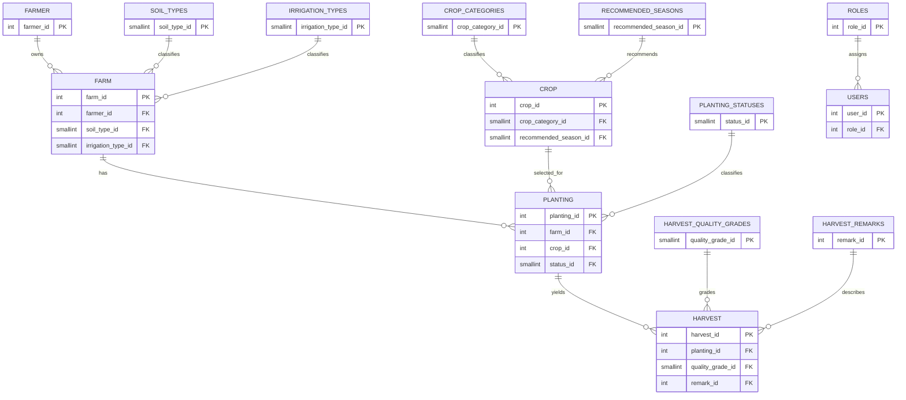

# Agriculture Information System — AP3 Midterm Project

**Cebu Technological University**  
**Submission documentation**  
**Application:** Agriculture Information System (AIS)  
**Stack:** Native PHP (OOP models and PDO), Supabase PostgreSQL, Tailwind CSS CDN, XAMPP Apache

> This document describes the checked-in implementation and migration history. A source-code review is not evidence of a successful current live database session. Items below explicitly distinguish implementation from tests and screenshots that still need evidence.

## 1. Project Title and Description

The **Agriculture Information System - AP3 Midterm Project, Cebu Technological University** is a web application for maintaining farmer, farm, crop, planting, and harvest records. Users authenticate through the `roles` lookup as `admin` or `staff`. The five operational modules provide record lists, forms, detail pages, and deletion routes; related values are displayed through SQL joins. The dashboard summarizes database records and the Reports area contains six report views.

### Architecture

Apache serves native PHP pages. Page scripts check the session/role, construct a PDO connection from `config/Database.php`, instantiate OOP model classes with that PDO connection, validate submitted values, and render HTML with Tailwind CDN. Models use prepared statements for database operations. PostgreSQL in Supabase stores business rows, lookup rows, user accounts, role assignments, constraints, and audit timestamps. Dynamic HTML values are escaped with `htmlspecialchars()`.

### Repository structure

```text
config/                 Database connection and private credential configuration
models/                 Farmer, Farm, Crop, Planting, Harvest, Lookup, User, Report
includes/               Shared header/footer, authentication checks, text helper
auth/                   Login and logout
farmers/                Farmer list, create, edit, view, delete
farms/                  Farm list, create, edit, view, delete
crops/                  Crop list, create, edit, view, delete
plantings/              Planting list, create, edit, view, delete
harvests/               Harvest list, create, edit, view, delete
reports/                Index and six report pages
database/               Ordered SQL migrations, seed/audit/maintenance scripts
index.php               Authenticated dashboard
```

Credentials are read by `config/Database.php` from the private `config/db_credentials.php`; `config/db_credentials.example.php` is the placeholder template. Do not include private credential values in the submitted documentation.

## 2. Project Objectives

- Organize agriculture information in related PostgreSQL relations with identifiable primary and foreign keys.
- Demonstrate the progression from the assignment's five core relations to a 3NF implementation, including lookup relations for fixed-choice labels.
- Implement account authentication, hashed passwords, protected pages, and distinct Administrator and Staff permissions.
- Support create, view, update, and delete workflows for the five operational modules, with validation, prepared statements, and understandable messages.
- Support record discovery through search, filters, sorting, and pagination.
- Summarize stored records in a database-backed dashboard and provide the six required reports.
- Protect referential integrity and retain creation/update timestamps on the five core tables.

## 3. Functional Requirements & Implementation

### Authentication and access control

- `auth/login.php` handles sign-in; `models/User.php::getByUsername()` retrieves the account and the login code uses `password_verify()` against `password_hash` before establishing session identity and role.
- `includes/auth_check.php::requireLogin()` protects authenticated pages, `isAdmin()` checks the current role, and `requireAdmin()` blocks non-admin write operations.
- `auth/logout.php` ends the session. `models/User.php::create()` and `updatePassword()` use `password_hash()`; the schema restricts roles to `admin` and `staff`.
- Staff can view application records and reports. Administrator can view, create, edit, and delete. Delete routes require Administrator and present a confirmation step in the UI.

### Dashboard

`index.php` is the post-login dashboard. It queries current database metrics for farmer, farm, crop, planting, and harvest totals; the five most recent plantings ordered by planting date/ID; the five most recent harvests ordered by harvest date/ID; counts grouped by every planting status; and total harvested kilograms. Values come from the database. Navigation is supplied through `includes/header.php` and dashboard links.

### Five operational modules

Each module has `index.php`, `create.php`, `edit.php`, `view.php`, and `delete.php`. The model method inventory and pages together implement the workflows:

| Module | Model methods | Implementing pages and related data |
|---|---|---|
| Farmers | `Farmer::getAll()`, `countAll()`, `getById()`, `hasDuplicate()`, `create()`, `update()`, `delete()` | `farmers/index.php`, `create.php`, `edit.php`, `view.php`, `delete.php`; list supports search/address filter, sort, pagination. |
| Farms | `Farm::getAll()`, `countAll()`, `getById()`, `getFarmers()`, `getIrrigationTypes()`, `getSoilTypes()`, `hasValidReferences()`, `hasDuplicateName()`, `create()`, `update()`, `delete()` | `farms/` pages; farmer and lookup labels are joined for display; owner, irrigation, and soil selections use database-fed options. |
| Crops | `Crop::getAll()`, `countAll()`, `getById()`, `getCategories()`, `getRecommendedSeasons()`, `hasValidReferences()`, `hasDuplicate()`, `create()`, `update()`, `delete()` | `crops/` pages; category and season are lookup-backed. Search/category filter, sorting and pagination are supported. |
| Plantings | `Planting::getAll()`, `countAll()`, `getById()`, `getFarms()`, `getCrops()`, `getStatuses()`, `hasValidReferences()`, `hasDuplicate()`, `create()`, `update()`, `delete()` | `plantings/` pages; joined farm, farmer, crop, and status details; status filter, search, sorting and pagination. |
| Harvests | `Harvest::getAll()`, `countAll()`, `getById()`, `getPlantingById()`, `getPlantings()`, `hasValidReferences()`, `hasDuplicate()`, `create()`, `update()`, `delete()` | `harvests/` pages; related planting/farm/crop/farmer and lookup labels are joined; grade filter, search, sorting and pagination. |

The page scripts validate inputs on the server, restrict write methods to Administrator, and show success/error feedback. Delete operations are attempted against the database; restrictive foreign keys prevent removing parent rows still referenced by children, and the page presents a friendly failure message.

### Controlled lookup dropdowns

`models/Lookup.php` provides `getHarvestRemarks()`, `getHarvestQualityGrades()`, `getPlantingStatuses()`, `getIrrigationTypes()`, `getSoilTypes()`, `getCropCategories()`, and `getRecommendedSeasons()`. Related options also come from model methods listed above. Forms submit integer lookup IDs; the corresponding labels are joined for display. The seven lookup relations are `soil_types`, `irrigation_types`, `crop_categories`, `recommended_seasons`, `planting_statuses`, `harvest_quality_grades`, and `harvest_remarks`.

### Search, filtering, sorting, and pagination

List-page model methods accept filters/search and paging/sort parameters. Farmers filter by address; farms by irrigation type; crops by category; plantings by status; harvests by quality grade. Each primary list has free-text search, sortable headings, and 10 rows per page. Sort keys are selected from page/model allowlists, sort direction is normalized, and page/offset values are passed to the model. The report filters are described above and the exact report implementation is in `models/Report.php` and `reports/*.php`.

### Input validation and audit timestamps

Form handlers validate server-side before persistence. Exact implemented rules include:

- **Farmers** (`farmers/create.php`, `farmers/edit.php`): all five fields are required; first/last name max 50 characters, contact max 20, address max 150; registration date must match `YYYY-MM-DD` and pass `checkdate()`. `capitalizeInput()` is applied to names and address. `Farmer::hasDuplicate()` checks normalized contact plus address OR same name plus address.
- **Farms** (`farms/create.php`, `farms/edit.php`): all six values required; farm name max 100, location max 150; area must match up to six integer digits and two decimals and be greater than zero. Farmer, soil, and irrigation IDs must be positive digit strings and exist (`Farm::hasValidReferences()`). Same-owner farm name duplicates are checked.
- **Crops** (`crops/create.php`, `crops/edit.php`): required crop name and variety max 80 characters; growing period must be a positive whole number within the signed integer range; category and season IDs must be positive and exist (`Crop::hasValidReferences()`). Duplicate crop-name/variety pairs are checked.
- **Plantings** (`plantings/create.php`, `plantings/edit.php`): required fields; area and seed quantity must be positive values with up to six integer digits and two decimal places; dates must be real `YYYY-MM-DD` dates, and expected harvest must be after planting. Farm, crop, and status IDs must exist. Exact duplicate planting details are checked.
- **Harvests** (`harvests/create.php`, `harvests/edit.php`): quantity must be positive and unit selling price nonnegative; each permits up to eight integer digits and two decimal places. Harvest date must be a real `YYYY-MM-DD` date and cannot be before its selected planting date. Planting, grade, and remark IDs must exist. Exact duplicate harvest details are checked.

The forms also set HTML `required`, `min`, `max`, and `step` attributes where appropriate; server checks remain authoritative. Database constraints provide a second integrity layer (Section 7). The five core tables have `created_at` and `updated_at`; migration `database/06_add_audit_timestamps.sql` installs a trigger to refresh `updated_at` on updates. The application does not store the responsible user's ID on business changes.

### Six reports

| Report | Page | Model methods and filters |
|---|---|---|
| Farmers and their farms | `reports/farmers_farms.php` | `countFarmersAndFarms()`, `getFarmersAndFarms()`; search spans farmer/contact/address and farm name/location; separate address substring filter; left joins retain farmers without farms. Sort and pagination are applied to the result list. |
| Crops planted per farm | `reports/crops_per_farm.php` | `getFarmOptions()`, `countCropsPlantedPerFarm()`, `getCropsPlantedPerFarm()`, `bindCropReportFilters()`; selected farm, inclusive planting-date range, search across farm/location/farmer/crop/variety, sort, and pagination. |
| Planting records by status | `reports/plantings_by_status.php` | `getPlantingStatusOptions()`, `getPlantingStatusSummary()`, `countPlantingsByStatus()`, `getPlantingsByStatus()`, `bindPlantingDates()`, `bindPlantingsByStatusFilters()`; status, inclusive planting-date range, search, sort, and pagination. Summary retains status options with zero matching plantings. |
| Harvest records | `reports/harvest_records.php` | `getHarvestQualityOptions()`, `countHarvestRecords()`, `getHarvestRecords()`, `bindHarvestReportFilters()`; grade, inclusive harvest-date range, search across related farmer/farm/crop/grade/remark labels, sort, and pagination. |
| Total harvested quantity | `reports/total_harvested_quantity.php` | `getTotalHarvestQuantity()`, `getHarvestQuantityByQuality()`; inclusive harvest-date range; returns harvest count, total kg, and quantity/count grouped by grade. |
| Estimated harvest value | `reports/estimated_harvest_value.php` | `getEstimatedHarvestValue()`, `getEstimatedHarvestValueByCrop()`; inclusive harvest-date range; sums `quantity_kg * selling_price_per_kg` overall and grouped by crop/variety. |

`reports/index.php` links to the six views. Report SQL is in `models/Report.php`; report PHP pages validate date filter strings before querying.

## 4. Entity-Relationship Diagram (ERD)



Text cardinalities: one farmer can own zero or many farms; each farm references one farmer. One farm can have zero or many plantings; each planting references one farm. One crop can appear in zero or many plantings; each planting references one crop. One planting can have zero or many harvest rows; each harvest references one planting. Each lookup row can be used by zero or many rows of its associated core table; each associated core row references one lookup row. One role can be assigned to zero or many user accounts; each account references one role.

The 14 relations are five core (`farmer`, `farm`, `crop`, `planting`, `harvest`), seven agriculture lookups, and two authentication relations (`users`, `roles`).

## 5. Database Normalization (UNF through 3NF)

The source guideline supplies five separate core table structures, not one combined denormalized record. The progression below does not invent a wide UNF table or repeating groups.

| Stage | Structure and reasoning |
|---|---|
| UNF (assignment starting point) | The five separate relations are FARMER(farmer_id, first_name, last_name, contact_number, address, date_registered); FARM(farm_id, farmer_id, farm_name, location, area_hectares, soil_type, irrigation_type); CROP(crop_id, crop_name, variety, crop_category, growing_period_days, recommended_season); PLANTING(planting_id, farm_id, crop_id, planting_date, area_planted, seed_quantity, expected_harvest_date, status); HARVEST(harvest_id, planting_id, harvest_date, quantity_kg, selling_price_per_kg, quality_grade, remarks). Each supplied column is scalar; no repeating group is specified. |
| 1NF | Keep each value atomic and one value per row/column. The listed fields already meet this representation; no structural split is needed at this stage. |
| 2NF | Each of the five relations has a single-column primary key. Since no composite key is used, there is no dependency on only part of a key. Keep attributes with their identified farmer, farm, crop, planting, or harvest entity. |
| 3NF implemented | Retain the five entity relations, add audit timestamps, and replace fixed-choice labels with foreign keys into seven lookup relations. A lookup label depends on its lookup key rather than being repeated in every business row. `users` and `roles` support authentication/authorization separately and are outside the agriculture assignment's five-relation normalization exercise. |

The changes from assignment labels to IDs are: `farm.soil_type` → `soil_type_id`; `farm.irrigation_type` → `irrigation_type_id`; `crop.crop_category` → `crop_category_id`; `crop.recommended_season` → `recommended_season_id`; `planting.status` → `status_id`; `harvest.quality_grade` → `quality_grade_id`; and `harvest.remarks` → `remark_id`. Migration `database/08_normalize_lookup_columns.sql` removes legacy label columns only after checking the label-to-ID mappings; migration 01 creates the harvest remarks lookup and relationship, and migration 02 creates the other fixed-value lookups and relationships.

For each core relation, the row key determines its non-key attributes. For example, `farmer_id` identifies the farmer's name, contact, address, and registration date. Lookup names are determined by lookup IDs. This avoids transitive storage of fixed-value labels in the business row. The separate `users` and `roles` relations do not alter the agriculture dependencies. Repeated contact numbers are not themselves a 3NF violation because the assignment does not define contact number as a candidate key.

## 6. Complete Data Dictionary

**DDL coverage note:** the repository has no initial `CREATE TABLE` migration for the five core tables. Their original column types and integer identity primary keys below are taken from the assignment schema reproduced in `PROJECT_REQUIREMENTS.md`; migrations 01–08 show the later lookup, constraint, and audit changes. The nullable/NOT NULL state of core fields is based on migration 07. Migration 01/02 lookup definitions are explicit. `users` is initially created in migration 05; migration 23 adds the `roles` lookup and replaces the text role field with `users.role_id`. This role migration is prepared but remains pending user execution in Supabase. `CURRENT_TIMESTAMP` applies to timestamp defaults where shown. `—` means no explicit default is declared in the included DDL. Lookup IDs have primary keys but no identity/default declaration in migrations 01/02.

### `farmer`

| Column | Data type & length | Key | Nullable | Default | Description |
|---|---|---|---|---|---|
| farmer_id | integer | PK | NOT NULL | identity-generated | Farmer identifier |
| first_name | varchar(50) | — | NOT NULL | — | Given name; nonblank check |
| last_name | varchar(50) | — | NOT NULL | — | Family name; nonblank check |
| contact_number | varchar(20) | — | NOT NULL | — | Contact number; nonblank check |
| address | varchar(150) | — | NOT NULL | — | Address; nonblank check |
| date_registered | date | — | NOT NULL | — | Registration date |
| created_at | timestamptz | — | NOT NULL | CURRENT_TIMESTAMP | Row creation time |
| updated_at | timestamptz | — | NOT NULL | CURRENT_TIMESTAMP | Refreshed by update trigger |

### `farm`

| Column | Data type & length | Key | Nullable | Default | Description |
|---|---|---|---|---|---|
| farm_id | integer | PK | NOT NULL | identity-generated | Farm identifier |
| farmer_id | integer | FK → farmer.farmer_id | NOT NULL | — | Owning farmer |
| farm_name | varchar(100) | UNIQUE with farmer_id | NOT NULL | — | Name, unique for that farmer |
| location | varchar(150) | — | NOT NULL | — | Farm location |
| area_hectares | numeric(8,2) | — | NOT NULL | — | Positive area in hectares |
| soil_type_id | smallint | FK → soil_types.soil_type_id | NOT NULL | — | Soil lookup |
| irrigation_type_id | smallint | FK → irrigation_types.irrigation_type_id | NOT NULL | — | Irrigation lookup |
| created_at | timestamptz | — | NOT NULL | CURRENT_TIMESTAMP | Row creation time |
| updated_at | timestamptz | — | NOT NULL | CURRENT_TIMESTAMP | Refreshed by update trigger |

### `crop`

| Column | Data type & length | Key | Nullable | Default | Description |
|---|---|---|---|---|---|
| crop_id | integer | PK | NOT NULL | identity-generated | Crop/variety record identifier |
| crop_name | varchar(80) | UNIQUE with variety | NOT NULL | — | Crop name; nonblank check |
| variety | varchar(80) | UNIQUE with crop_name | NOT NULL | — | Variety; nonblank check |
| crop_category_id | smallint | FK → crop_categories.crop_category_id | NOT NULL | — | Category lookup |
| growing_period_days | integer | — | NOT NULL | — | Positive growing duration |
| recommended_season_id | smallint | FK → recommended_seasons.recommended_season_id | NOT NULL | — | Season lookup |
| created_at | timestamptz | — | NOT NULL | CURRENT_TIMESTAMP | Row creation time |
| updated_at | timestamptz | — | NOT NULL | CURRENT_TIMESTAMP | Refreshed by update trigger |

### `planting`

| Column | Data type & length | Key | Nullable | Default | Description |
|---|---|---|---|---|---|
| planting_id | integer | PK | NOT NULL | identity-generated | Planting identifier |
| farm_id | integer | FK → farm.farm_id | NOT NULL | — | Farm used |
| crop_id | integer | FK → crop.crop_id | NOT NULL | — | Crop/variety planted |
| planting_date | date | — | NOT NULL | — | Date planted |
| area_planted | numeric(8,2) | — | NOT NULL | — | Positive area planted |
| seed_quantity | numeric(8,2) | — | NOT NULL | — | Positive seed quantity |
| expected_harvest_date | date | — | NOT NULL | — | Must be later than planting date |
| status_id | smallint | FK → planting_statuses.status_id | NOT NULL | — | Status lookup |
| created_at | timestamptz | — | NOT NULL | CURRENT_TIMESTAMP | Row creation time |
| updated_at | timestamptz | — | NOT NULL | CURRENT_TIMESTAMP | Refreshed by update trigger |

### `harvest`

| Column | Data type & length | Key | Nullable | Default | Description |
|---|---|---|---|---|---|
| harvest_id | integer | PK | NOT NULL | identity-generated | Harvest identifier |
| planting_id | integer | FK → planting.planting_id | NOT NULL | — | Source planting |
| harvest_date | date | — | NOT NULL | — | Harvest date; app rejects before planting date |
| quantity_kg | numeric(10,2) | — | NOT NULL | — | Positive harvested weight |
| selling_price_per_kg | numeric(10,2) | — | NOT NULL | — | Nonnegative unit price |
| quality_grade_id | smallint | FK → harvest_quality_grades.quality_grade_id | NOT NULL | — | Quality lookup |
| remark_id | integer | FK → harvest_remarks.remark_id | NOT NULL | — | Remark lookup |
| created_at | timestamptz | — | NOT NULL | CURRENT_TIMESTAMP | Row creation time |
| updated_at | timestamptz | — | NOT NULL | CURRENT_TIMESTAMP | Refreshed by update trigger |

### Lookup and authentication relations

| Relation.Column | Data type & length | Key | Nullable | Default | Description |
|---|---|---|---|---|---|
| soil_types.soil_type_id | smallint | PK | NOT NULL | — (migration does not declare identity/default) | Soil option ID |
| soil_types.soil_type_name | varchar(50) | UNIQUE | NOT NULL | — | Soil label |
| irrigation_types.irrigation_type_id | smallint | PK | NOT NULL | — (migration does not declare identity/default) | Irrigation option ID |
| irrigation_types.irrigation_type_name | varchar(50) | UNIQUE | NOT NULL | — | Irrigation label |
| crop_categories.crop_category_id | smallint | PK | NOT NULL | — (migration does not declare identity/default) | Category option ID |
| crop_categories.crop_category_name | varchar(50) | UNIQUE | NOT NULL | — | Category label |
| recommended_seasons.recommended_season_id | smallint | PK | NOT NULL | — (migration does not declare identity/default) | Season option ID |
| recommended_seasons.recommended_season_name | varchar(30) | UNIQUE | NOT NULL | — | Season label |
| planting_statuses.status_id | smallint | PK | NOT NULL | — (migration does not declare identity/default) | Status option ID |
| planting_statuses.status_name | varchar(30) | UNIQUE | NOT NULL | — | Status label |
| harvest_quality_grades.quality_grade_id | smallint | PK | NOT NULL | — (migration does not declare identity/default) | Grade option ID |
| harvest_quality_grades.quality_grade_name | varchar(30) | UNIQUE | NOT NULL | — | Grade label |
| harvest_remarks.remark_id | integer | PK | NOT NULL | — (migration does not declare identity/default) | Remark option ID |
| harvest_remarks.remark_description | varchar(50) | UNIQUE | NOT NULL | — | Remark label |
| users.user_id | integer | PK | NOT NULL | GENERATED BY DEFAULT AS IDENTITY | Account identifier |
| users.username | varchar(50) | UNIQUE | NOT NULL | — | Login name |
| users.password_hash | varchar(255) | — | NOT NULL | — | PHP password hash |
| users.role_id | integer | FK → roles.role_id | NOT NULL | — | Authorization role lookup |
| users.created_at | timestamptz | — | NOT NULL | CURRENT_TIMESTAMP | Account creation time |
| roles.role_id | integer | PK | NOT NULL | identity-generated | Role identifier |
| roles.role_name | varchar(30) | UNIQUE, CHECK: admin/staff | NOT NULL | — | Authorization role name |

Migration 02 seeds lookup labels as follows: soil `Loam`, `Clay Loam`, `Sandy Loam`, `Clay`; irrigation `Rainfed`, `Irrigated`, `Drip Irrigation`; categories `Cereal`, `Vegetable`, `Fruit`, `Legume`, `Root Crop`; seasons `Wet Season`, `Dry Season`, `Year Round`; statuses `Harvested`, `Growing`; grades `Grade A`, `Grade B`, `Grade C`. Migration 01's remarks are `Good Harvest`, `Acceptable Quality`, `Low Yield`, `Poor Quality`, `Damaged Harvest`.

Migration 23 adds `roles` with `admin` and `staff`, backfills `users.role_id` from the previous `users.role` values, validates the mapping, and then drops the old text column. The user confirmed the migration in Supabase; the screenshot shows the foreign-key, old-column removal, and user-role validation checks all true.

## 7. Table Relationships and Constraints

### Relationships and delete behavior

The included migrations declare foreign keys without `ON DELETE` clauses, so PostgreSQL's default is `NO ACTION` (effectively preventing parent deletion while dependent rows remain). The lookup FKs are explicitly added by migrations 01/02. The baseline farmer→farm, farm/crop→planting, and planting→harvest relationships are part of the assignment schema and application queries, but their original `CREATE TABLE`/`ALTER TABLE` statements are not in the checked-in migration set. The application catches delete failures and does not intentionally cascade-delete child records. Thus the `NO ACTION` description for baseline relationships reflects PostgreSQL's default if those FKs exist without an override; inspect the live Supabase catalog for final deployed constraint confirmation.

| Foreign key | Cardinality | Delete behavior |
|---|---|---|
| farm.farmer_id → farmer.farmer_id | Farmer 1:M Farm | NO ACTION/default; referenced farmer deletion is blocked |
| farm.soil_type_id → soil_types.soil_type_id | Soil 1:M Farm | NO ACTION/default |
| farm.irrigation_type_id → irrigation_types.irrigation_type_id | Irrigation 1:M Farm | NO ACTION/default |
| crop.crop_category_id → crop_categories.crop_category_id | Category 1:M Crop | NO ACTION/default |
| crop.recommended_season_id → recommended_seasons.recommended_season_id | Season 1:M Crop | NO ACTION/default |
| planting.farm_id → farm.farm_id | Farm 1:M Planting | NO ACTION/default; referenced farm deletion is blocked |
| planting.crop_id → crop.crop_id | Crop 1:M Planting | NO ACTION/default; referenced crop deletion is blocked |
| planting.status_id → planting_statuses.status_id | Status 1:M Planting | NO ACTION/default |
| harvest.planting_id → planting.planting_id | Planting 1:M Harvest | NO ACTION/default; referenced planting deletion is blocked |
| harvest.quality_grade_id → harvest_quality_grades.quality_grade_id | Grade 1:M Harvest | NO ACTION/default |
| harvest.remark_id → harvest_remarks.remark_id | Remark 1:M Harvest | NO ACTION/default |
| users.role_id → roles.role_id | Role 1:M User | ON DELETE RESTRICT |

### Declared primary, unique, not-null, and check constraints

- **Primary keys:** the five core IDs, seven lookup IDs, `roles.role_id`, and `users.user_id`. Core and account identifiers use integer identity columns; lookup key types are shown in Section 6.
- **Unique:** `users.username`, `roles.role_name`, each agriculture lookup label, `(farm.farmer_id, farm.farm_name)`, and `(crop.crop_name, crop.variety)`.
- **Not null:** required business fields, lookup labels/IDs, `roles.role_name`, and all account fields including `users.role_id`.
- **Checks:** required farmer names/contact/address and farm/crop strings must not be blank; farm area > 0; crop growing period > 0; planting area and seed quantity > 0; expected harvest date > planting date; harvest quantity > 0; selling price ≥ 0; `roles.role_name IN ('admin','staff')`.
- **Audit:** migration 06 supplies `created_at` and `updated_at` defaults and installs `set_updated_at()` before-update triggers on the five core tables.
- **Duplicate triggers:** migration 18 installs trigger guards for five core relations. Farmer matching is normalized contact plus address OR normalized full name plus address; farm uses owner/name; crop uses name/variety; planting and harvest compare all business fields in their respective records. These triggers raise unique-violation errors; they are not declared UNIQUE constraints.

### Application-level validation

The form handlers require the expected values, cast IDs/numeric fields, validate date syntax and logical date ordering, check selected parent/lookup IDs through model reference-check methods, and call module duplicate checks. Farmer duplicate checking is a likely-duplicate warning rule (contact plus address, or full name plus address), not a unique-phone database rule. Farm name and crop/variety checks correspond to their database unique keys. Planting and harvest exact duplicates are also guarded by model methods and migration 18 triggers. All SQL statements use prepared parameters where user-supplied values are used.

## 8. Screenshots of the Working System

Insert actual captures from the running application. The placeholders intentionally make no claim that evidence has already been captured. Hide credentials and any personal information that is not approved for submission.

1. [Insert Screenshot: Login page]
2. [Insert Screenshot: Administrator dashboard with database metrics]
3. [Insert Screenshot: Farmers list]
4. [Insert Screenshot: Farmers create form]
5. [Insert Screenshot: Farmers edit form]
6. [Insert Screenshot: Farmers delete confirmation]
7. [Insert Screenshot: Farms list]
8. [Insert Screenshot: Farms create form]
9. [Insert Screenshot: Farms edit form]
10. [Insert Screenshot: Farms delete confirmation]
11. [Insert Screenshot: Crops list]
12. [Insert Screenshot: Crops create form]
13. [Insert Screenshot: Crops edit form]
14. [Insert Screenshot: Crops delete confirmation]
15. [Insert Screenshot: Plantings list]
16. [Insert Screenshot: Plantings create form]
17. [Insert Screenshot: Plantings edit form]
18. [Insert Screenshot: Plantings delete confirmation]
19. [Insert Screenshot: Harvests list]
20. [Insert Screenshot: Harvests create form]
21. [Insert Screenshot: Harvests edit form]
22. [Insert Screenshot: Harvests delete confirmation]
23. [Insert Screenshot: Report — Farmers and their farms]
24. [Insert Screenshot: Report — Crops planted per farm]
25. [Insert Screenshot: Report — Planting records by status]
26. [Insert Screenshot: Report — Harvest records]
27. [Insert Screenshot: Report — Total harvested quantity]
28. [Insert Screenshot: Report — Estimated harvest value]
29. [Insert Screenshot: Desktop layout at 1440 CSS pixels]
30. [Insert Screenshot: Tablet layout at 768 CSS pixels (simulated browser viewport)]
31. [Insert Screenshot: Mobile layout]

## 9. System Testing Results

The matrix is a truthful execution record, not a claim that every live workflow passed. Repository notes record earlier syntax checks, local route/auth checks, and validation checks; the final end-to-end run against current Supabase data is still pending. Replace `Not run for this submission` only after executing and recording actual outcomes. Do not infer a pass from the presence of code.

| Test ID | Module | Test scenario & input | Expected result | Actual result | Status |
|---|---|---|---|---|---|
| T01 | Authentication | Sign in with valid Administrator account/password | Session established; dashboard shown | Not run for this submission | Pending |
| T02 | Authentication | Wrong password or unknown username | Login rejected with friendly message; no session | Not run for this submission | Pending |
| T03 | RBAC | Open protected page without login | Redirect to login | Earlier local route check recorded redirects for protected routes; repeat on final build | Earlier check; rerun |
| T04 | RBAC | Staff submits create/edit/delete request | Request denied; no row changed | Not run for this submission | Pending |
| T05 | RBAC | Administrator opens delete action and cancels confirmation | No deletion performed | Not run for this submission | Pending |
| T06 | Farmers CRUD | Admin creates valid farmer, views, edits, then deletes unreferenced test row | Changes persist; success messages; deletion succeeds | Not run against current populated data | Pending |
| T07 | Farms CRUD/FK | Create valid farm linked to existing farmer and lookup IDs | Farm persists and joined labels display | Not run for this submission | Pending |
| T08 | Crops CRUD | Create valid crop/category/season, then edit and view | Data persists and joined labels display | Not run for this submission | Pending |
| T09 | Plantings CRUD/FK | Create planting using existing farm, crop, status | Persists; farm/crop details shown | Not run for this submission | Pending |
| T10 | Harvests CRUD/FK | Create harvest using existing planting, grade, remark | Persists; related details and labels shown | Not run for this submission | Pending |
| T11 | Foreign-key delete protection | Attempt to delete farmer/farm/crop/planting with dependent rows | Delete rejected; dependent data retained; friendly message | Earlier behavior is implemented; live populated-data case not rerun | Pending live verification |
| T12 | Validation | Submit blank required text or missing dropdown | Save rejected; field-level/friendly error | Not run for this submission | Pending |
| T13 | Validation | Enter malformed date | Save rejected; no database write | Not run for this submission | Pending |
| T14 | Validation | Expected harvest date on/before planting date | Save rejected | Database check exists; current form test not run for this submission | Pending |
| T15 | Validation | Enter zero/negative farm area, growing days, planted area, seed, or harvest quantity | Save rejected | Database checks exist; current form test not run for this submission | Pending |
| T16 | Validation | Enter negative selling price | Save rejected | Database check exists; current form test not run for this submission | Pending |
| T17 | Duplicate prevention | Submit duplicate farmer candidate, duplicate farm owner/name, duplicate crop/variety, exact planting or harvest | Duplicate blocked with understandable message | Migration 18 was confirmed installed; current live attempts not run for this submission | Pending live verification |
| T18 | Lists | Search and apply each module's documented filter | Matching rows only; counts/pagination remain consistent | Earlier module checks recorded; current populated-data rerun pending | Earlier check; rerun |
| T19 | Lists | Sort useful columns ascending/descending; move page | Correct order/page; no broken links | Earlier module checks recorded; current populated-data rerun pending | Earlier check; rerun |
| T20 | Lookups/joins | Inspect create dropdowns and joined list/detail values for all fixed fields | Options from lookup rows; labels match stored IDs | Migration mapping checks previously returned zero mismatches; final UI check pending | Earlier database check; rerun UI |
| T21 | Dashboard | Compare five totals, recent activity, status summary and harvested total with DB rows | Displayed values match query results | Earlier dashboard code path checked; current populated-data reconciliation pending | Pending |
| T22 | Report | Run Farmers and Farms with address/search filters | Correct joined farmer/farm rows | Report query paths previously checked when tables were empty; populated-data verification pending | Pending |
| T23 | Report | Run Crops per Farm with farm/date/search filters | Correct matching planting rows | Not run against current populated data | Pending |
| T24 | Report | Run Plantings by Status with status/date filters | Correct rows and summary | Not run against current populated data | Pending |
| T25 | Report | Run Harvest Records with quality/date/search filters | Correct harvest rows | Not run against current populated data | Pending |
| T26 | Report | Run Total Harvested Quantity for date range | Sum matches included harvest rows | Not run against current populated data | Pending |
| T27 | Report | Run Estimated Harvest Value for date range | Sum of quantity × unit price matches included rows | Not run against current populated data | Pending |
| T28 | Error handling | Force a database/constraint failure through a safe test case | Friendly message; no credentials/connection details/raw exception exposed | Earlier output scan recorded no raw SQLSTATE/exception/credential output; current UI rerun pending | Earlier check; rerun |
| T29 | Responsive UI | Capture desktop 1440, simulated tablet 768, and mobile layout | Navigation/forms/tables remain usable | No final rendered device evidence recorded | Pending |

Previously recorded checks include PHP syntax checks, earlier authenticated route smoke tests, earlier login/role route checks, an integer boundary check for crop growing days (2147483648 rejected and 2147483647 accepted), and migration 08 mapping checks. These are historical checks, not evidence that the current live system passes the pending workflows. The project tracker reports live populated-data CRUD/report verification and final screenshots as outstanding.

## 10. User Guide / Basic Operating Instructions

### Start and sign in

1. Start Apache in XAMPP. Ensure the PHP `pdo_pgsql` and `pgsql` extensions are enabled.
2. Configure the private `config/db_credentials.php` from `config/db_credentials.example.php`; do not expose the file or its values.
3. Open `http://localhost/FMidterm_Project/`.
4. Enter an account already provisioned in `public.users`. Successful login opens the dashboard. Use the account's assigned role; passwords are stored as hashes.

### Dashboard and navigation

Use the main navigation or dashboard links to open Farmers, Farms, Crops, Plantings, Harvests, or Reports. Dashboard totals and activity are sourced from the connected database. Use the shared navigation/settings menu to log out when finished.

### Administrator: manage records

1. Create or confirm a Farmer before adding a Farm.
2. Add a Farm and select its Farmer, soil type, and irrigation type from dropdowns.
3. Add a Crop and select its category and recommended season.
4. Add a Planting by selecting an existing Farm, Crop, and Status; enter planting/expected-harvest dates, planted area, and seed quantity.
5. Add a Harvest by selecting an existing Planting, quality grade, and remark; enter harvest date, quantity, and unit selling price.
6. Use a module list's search, filter, sortable heading, and pagination controls to locate records. Open View for joined details. Use Edit to change a record. Use Delete only after reviewing its confirmation; a record referenced by child rows cannot be deleted until those dependencies are resolved.
7. Required fields, numeric ranges, dates, existing relationships, and duplicate rules are checked before saving and by applicable database constraints. Review success/error messages after each action.

### Staff: view and report

Staff can navigate lists and detail views, use available search/filter/sort/pagination controls, and open reports. Create, edit, and delete operations are Administrator-only.

### Generate reports

Open Reports and select one of the six report pages. Apply the relevant search, lookup, farm, status/quality, or date-range filter, then review the returned rows and totals. Estimated harvest value is quantity in kilograms multiplied by selling price per kilogram. Report pages use current database contents; confirm the displayed filters before using a total.

### Log out

Use the Logout action in the navigation/settings menu to end the session. Close the browser after logging out on a shared computer.

---

**Implementation evidence sources:** PHP files under `models/`, `auth/`, `includes/`, `farmers/`, `farms/`, `crops/`, `plantings/`, `harvests/`, `reports/`, and `index.php`; SQL migrations under `database/`; `PROJECT_REQUIREMENTS.md`; `PROJECT_DOCUMENTATION.md`; and the source guideline `ap3 project.docx`. Migration files represent project history; when no migration shows an identity/default declaration for lookup IDs, this document does not assume one.
