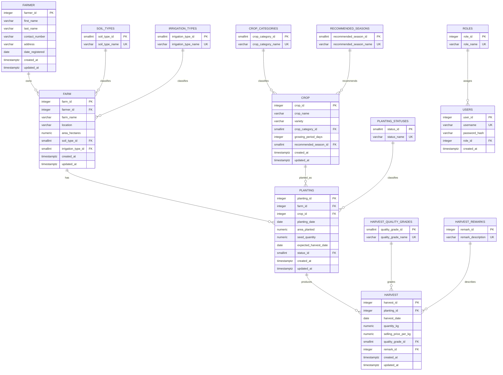
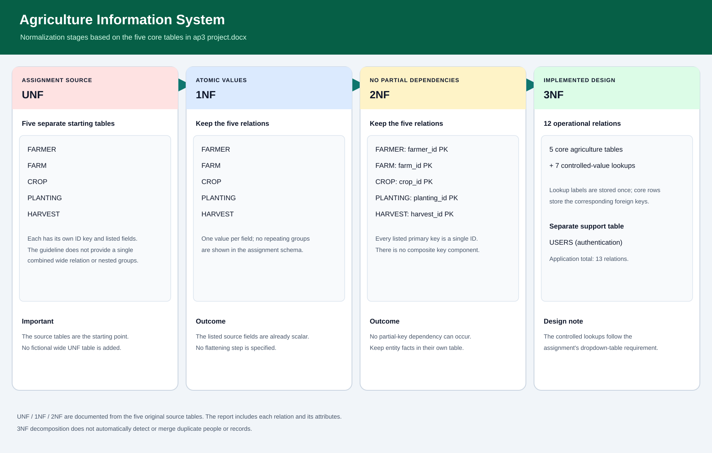

# Agriculture Information System (AIS)

**Course project:** AP3 Web Application Development Midterm Project  
**Institution:** Cebu Technological University  
**Application:** Native PHP with PDO, Supabase PostgreSQL, XAMPP Apache, and Tailwind CSS CDN

**Documentation status:** Updated 12 November 2026 against the original [`ap3 project.docx`](ap3%20project.docx). The report describes the implemented system and known verification status. Final screenshots and rendered phone/tablet/desktop checks are reserved for the student to capture.

## 1. Project description

The AIS stores farmers, farms, crops, planting operations, and harvest yields. Users sign in as an administrator or staff member. The application provides validated CRUD screens, search and filters, dashboard totals, and reports that join related records.

## 2. Objectives

- Organize agriculture records in a relational PostgreSQL database.
- Demonstrate normalization, primary and foreign keys, and database constraints.
- Provide secure login with role-based access and hashed passwords.
- Validate records before saving and present useful messages.
- Summarize planting and harvest activity through a dashboard and reports.

## 3. Functional requirements

- Manage farmers, farms, crops, plantings, and harvests through create, read, update, and delete operations.
- Use lookup tables for soil type, irrigation type, crop category, recommended season, planting status, harvest quality, and harvest remarks.
- Show related farm, farmer, crop, quality, and remark data through SQL joins.
- Search, filter, sort, and paginate major data lists.
- Restrict permanent deletion to administrators and prevent deletes that would violate foreign keys.
- Provide a dashboard and the six required reports.
- Require login for application pages and store password hashes in `public.users`.

The six report topics are: farmers and their farms; crops planted per farm; plantings by status; harvest records; total harvested quantity; and estimated harvest value (`quantity × selling price`). Reports use database queries and provide relevant filters, including date ranges where applicable.

## 4. Requirement coverage

| Guideline area | Implementation and current evidence |
|---|---|
| Normalization | UNF, 1NF, 2NF, and 3NF are compared below using the five separate core tables named in `ap3 project.docx`. The guideline does not define one combined wide UNF table. Lookup labels are stored in related tables and referenced by IDs; migration 08 was confirmed applied. |
| Supabase database | Five business tables, seven lookup tables, and `users` are documented. The current schema is intended to be used through PDO and Supabase PostgreSQL. Recheck the current connection and populated data before the final demo. |
| Controlled values | Soil, irrigation, crop category, season, planting status, harvest quality, and harvest remarks are lookup-backed dropdowns. |
| CRUD, validation, and relationships | All five business modules have list/create/edit/view/delete routes, input validation, related-record joins, and Admin/Staff rules. Final CRUD checks against the current populated database remain pending. |
| Dashboard and reports | The dashboard reads database totals and recent activity. Six report views cover the required report topics; final populated-data checks remain pending. |
| Search, filters, sorting, and pagination | Implemented on the business list pages; full current-data verification remains pending. |
| Data integrity | Required, range, date, foreign-key, and selected unique constraints are recorded below. Duplicate audit candidates require review; 3NF alone does not remove repeated entity rows. |
| Responsive interface | Responsive styles and horizontally scrollable wide tables are implemented. The student will capture real iOS and Android phone views, simulate a 768 CSS-pixel tablet viewport, and capture desktop at 1440 CSS pixels. |
| Evidence and readiness | Screenshots, final populated-data test evidence, demo rehearsal, and final submission cleanup remain outstanding. Do not report these as complete until evidence is added. |

## 5. Entity relationship diagram

`USERS` authenticates application users and references `ROLES` for authorization. `created_at` and `updated_at` are maintained for the five business tables. The current application does not record the user responsible for each edit.

## 6. Normalization (UNF to 3NF)

This comparison follows the five starting relations explicitly listed in `ap3 project.docx`: FARMER, FARM, CROP, PLANTING, and HARVEST. The assignment does not provide a single denormalized, all-in-one relation or repeating groups. Therefore this documentation does not invent a wide UNF row. `PK` means primary key; `FK` means foreign key; `UK` means unique key.

| Stage | FARMER | FARM | CROP | PLANTING | HARVEST | Result |
|---|---|---|---|---|---|---|
| UNF (assignment starting structures) | farmer_id (PK), first_name, last_name, contact_number, address, date_registered | farm_id (PK), farmer_id (FK), farm_name, location, area_hectares, soil_type, irrigation_type | crop_id (PK), crop_name, variety, crop_category, growing_period_days, recommended_season | planting_id (PK), farm_id (FK), crop_id (FK), planting_date, area_planted, seed_quantity, expected_harvest_date, status | harvest_id (PK), planting_id (FK), harvest_date, quantity_kg, selling_price_per_kg, quality_grade, remarks | These are the five separate source tables as supplied. Their listed fields are scalar; the guideline does not show a repeating group. |
| 1NF | Same attributes; one value per field | Same attributes; one value per field | Same attributes; one value per field | Same attributes; one value per field | Same attributes; one value per field | The supplied structures already show atomic fields. No flattening into a fabricated wide table is necessary. |
| 2NF | Same relation; single-column farmer_id PK | Same relation; single-column farm_id PK | Same relation; single-column crop_id PK | Same relation; single-column planting_id PK | Same relation; single-column harvest_id PK | Each relation has a single-column key, so there can be no partial dependency on part of a composite key. Keep the five entities separate. |
| 3NF (implemented design) | farmer_id PK, first_name, last_name, contact_number, address, date_registered, created_at, updated_at | farm_id PK, farmer_id FK, farm_name, location, area_hectares, soil_type_id FK, irrigation_type_id FK, created_at, updated_at | crop_id PK, crop_name, variety, crop_category_id FK, growing_period_days, recommended_season_id FK, created_at, updated_at | planting_id PK, farm_id FK, crop_id FK, planting_date, area_planted, seed_quantity, expected_harvest_date, status_id FK, created_at, updated_at | harvest_id PK, planting_id FK, harvest_date, quantity_kg, selling_price_per_kg, quality_grade_id FK, remark_id FK, created_at, updated_at | The five core relations remain separate. Fixed-choice labels use lookup IDs per the assignment's controlled-dropdown rule. |

### 3NF relation inventory

The implemented application has 12 agriculture relations: five core relations plus seven controlled-value lookup relations. `users` and `roles` support authentication and authorization and are separate from the five-table agriculture normalization exercise. The database therefore has 14 application relations in total.

| Relation | Attributes (PK/FK marked) |
|---|---|
| farmer | farmer_id (PK), first_name, last_name, contact_number, address, date_registered, created_at, updated_at |
| farm | farm_id (PK), farmer_id (FK), farm_name, location, area_hectares, soil_type_id (FK), irrigation_type_id (FK), created_at, updated_at |
| crop | crop_id (PK), crop_name, variety, crop_category_id (FK), growing_period_days, recommended_season_id (FK), created_at, updated_at |
| planting | planting_id (PK), farm_id (FK), crop_id (FK), planting_date, area_planted, seed_quantity, expected_harvest_date, status_id (FK), created_at, updated_at |
| harvest | harvest_id (PK), planting_id (FK), harvest_date, quantity_kg, selling_price_per_kg, quality_grade_id (FK), remark_id (FK), created_at, updated_at |
| soil_types | soil_type_id (PK), soil_type_name (UK) |
| irrigation_types | irrigation_type_id (PK), irrigation_type_name (UK) |
| crop_categories | crop_category_id (PK), crop_category_name (UK) |
| recommended_seasons | recommended_season_id (PK), recommended_season_name (UK) |
| planting_statuses | status_id (PK), status_name (UK) |
| harvest_quality_grades | quality_grade_id (PK), quality_grade_name (UK) |
| harvest_remarks | remark_id (PK), remark_description (UK) |
| users (authentication support) | user_id (PK), username (UK), password_hash, role_id (FK), created_at |
| roles (authorization lookup) | role_id (PK), role_name (UK; `admin` or `staff`) |

The assignment's original fixed-choice text attributes (`soil_type`, `irrigation_type`, `crop_category`, `recommended_season`, `status`, `quality_grade`, and `remarks`) are represented by foreign keys in the implemented design. Each label is kept once in its lookup relation, and application queries join the label for display. This implements the assignment's explicit lookup-table requirement; it does not imply that the assignment's five source tables had a repeating group or a partial dependency. The migration to lookup IDs was confirmed by the user as applied in Supabase (`database/08_normalize_lookup_columns.sql`).

### 3NF dependency and contact-number check

In each core relation, the single-column primary key identifies that row's remaining attributes (for example, `farmer_id` determines a farmer's name, contact number, address, and registration date). The related lookup labels depend on their lookup IDs and are reached through foreign keys. This avoids storing the same soil, irrigation, crop category, season, planting status, grade, or harvest remark text redundantly in every business row. The documented design therefore satisfies the assignment's 3NF goal for the listed attributes.

`farmer.contact_number` is an ordinary farmer attribute, not a declared candidate key in `ap3 project.docx`. The guideline does not say that every farmer must have a globally unique phone number. Repeated phone values do not by themselves violate 3NF; they are a data-quality issue to review under the project's duplicate-entry rule. Do not add `UNIQUE(contact_number)` or merge farmers solely to force phone uniqueness. If the project owner later adopts a rule that one phone can belong to only one farmer, that is a separate business constraint and needs review of existing records before enforcement.

## 7. Data dictionary

| Table | Column | Type | Meaning / rule |
|---|---|---|---|
| farmer | farmer_id | integer PK | Identity for a farmer |
| farmer | first_name | varchar(50) | Required given name |
| farmer | last_name | varchar(50) | Required family name |
| farmer | contact_number | varchar(20) | Required contact detail |
| farmer | address | varchar(150) | Required address; used by address filter |
| farmer | date_registered | date | Required registration date |
| farmer | created_at | timestamptz | Creation time |
| farmer | updated_at | timestamptz | Automatically refreshed update time |
| farm | farm_id | integer PK | Identity for a farm |
| farm | farmer_id | integer FK | Owner in `farmer` |
| farm | farm_name | varchar(100) | Required farm name; unique per farmer |
| farm | location | varchar(150) | Required farm location |
| farm | area_hectares | numeric(8,2) | Positive farm area |
| farm | soil_type_id | smallint FK | `soil_types` lookup |
| farm | irrigation_type_id | smallint FK | `irrigation_types` lookup |
| farm | created_at | timestamptz | Creation time |
| farm | updated_at | timestamptz | Automatically refreshed update time |
| crop | crop_id | integer PK | Identity for a crop/variety |
| crop | crop_name | varchar(80) | Required crop name |
| crop | variety | varchar(80) | Required variety; crop and variety are unique together |
| crop | crop_category_id | smallint FK | `crop_categories` lookup |
| crop | growing_period_days | integer | Positive number of days |
| crop | recommended_season_id | smallint FK | `recommended_seasons` lookup |
| crop | created_at | timestamptz | Creation time |
| crop | updated_at | timestamptz | Automatically refreshed update time |
| planting | planting_id | integer PK | Identity for a planting operation |
| planting | farm_id | integer FK | Selected farm |
| planting | crop_id | integer FK | Selected crop and variety |
| planting | planting_date | date | Date planted |
| planting | area_planted | numeric(8,2) | Positive planted area |
| planting | seed_quantity | numeric(8,2) | Positive quantity of seed used |
| planting | expected_harvest_date | date | Must be after planting date |
| planting | status_id | smallint FK | `planting_statuses` lookup |
| planting | created_at | timestamptz | Creation time |
| planting | updated_at | timestamptz | Automatically refreshed update time |
| harvest | harvest_id | integer PK | Identity for a harvest record |
| harvest | planting_id | integer FK | Planting that produced the harvest |
| harvest | harvest_date | date | Must not precede planting date in application validation |
| harvest | quantity_kg | numeric(10,2) | Positive harvested quantity |
| harvest | selling_price_per_kg | numeric(10,2) | Nonnegative unit price |
| harvest | quality_grade_id | smallint FK | `harvest_quality_grades` lookup |
| harvest | remark_id | integer FK | `harvest_remarks` lookup |
| harvest | created_at | timestamptz | Creation time |
| harvest | updated_at | timestamptz | Automatically refreshed update time |
| soil_types | soil_type_id | smallint PK | Soil lookup key |
| soil_types | soil_type_name | varchar(50) UNIQUE | Controlled soil label |
| irrigation_types | irrigation_type_id | smallint PK | Irrigation lookup key |
| irrigation_types | irrigation_type_name | varchar(50) UNIQUE | Controlled irrigation label |
| crop_categories | crop_category_id | smallint PK | Crop category lookup key |
| crop_categories | crop_category_name | varchar(50) UNIQUE | Controlled crop category label |
| recommended_seasons | recommended_season_id | smallint PK | Season lookup key |
| recommended_seasons | recommended_season_name | varchar(30) UNIQUE | Controlled growing-season label |
| planting_statuses | status_id | smallint PK | Planting status lookup key |
| planting_statuses | status_name | varchar(30) UNIQUE | Controlled planting status |
| harvest_quality_grades | quality_grade_id | smallint PK | Quality lookup key |
| harvest_quality_grades | quality_grade_name | varchar(30) UNIQUE | Controlled quality grade |
| harvest_remarks | remark_id | integer PK | Harvest remark lookup key |
| harvest_remarks | remark_description | varchar(50) UNIQUE | Controlled harvest remark |
| users | user_id | integer PK | Identity for an application account |
| users | username | varchar(50) UNIQUE | Login name |
| users | password_hash | varchar(255) | Password hash, never plaintext |
| users | role_id | integer FK | References `roles.role_id` for the account's authorization role |
| users | created_at | timestamptz | Account creation time |
| roles | role_id | integer PK | Identity for an authorization role |
| roles | role_name | varchar(30) UNIQUE | `admin` or `staff`; referenced by user accounts |

### Lookup values

| Lookup table | Values |
|---|---|
| soil_types | Loam; Clay Loam; Sandy Loam; Clay |
| irrigation_types | Rainfed; Irrigated; Drip Irrigation |
| crop_categories | Cereal; Vegetable; Fruit; Legume; Root Crop |
| recommended_seasons | Wet Season; Dry Season; Year Round |
| planting_statuses | Harvested; Growing |
| harvest_quality_grades | Grade A; Grade B; Grade C |
| harvest_remarks | Good Harvest; Acceptable Quality; Low Yield; Poor Quality; Damaged Harvest |
| roles | admin; staff |

## 8. Relationships and constraints

### Relationships

| Parent | Relationship | Child | Meaning |
|---|---|---|---|
| FARMER | 1:M | FARM | A farmer may own multiple farms; each farm has one farmer. |
| FARM | 1:M | PLANTING | A farm may have multiple planting records. |
| CROP | 1:M | PLANTING | A crop/variety may be used in multiple plantings. |
| PLANTING | 1:M | HARVEST | A planting may have multiple harvest records. |
| Each lookup table | 1:M | Related core table | A lookup label may be referenced by multiple business records. |
| ROLES | 1:M | USERS | Each account has one role; a role may be assigned to multiple accounts. |

### Integrity rules

- Primary keys identify all records. Foreign keys connect business and lookup records and protect referential integrity.
- Required fields use `NOT NULL`; required text fields also reject blank values.
- Farm area, crop growing period, planting area, seed quantity, and harvest quantity must be positive. Harvest price must be zero or positive.
- A planting's expected harvest date must be later than its planting date. The application also rejects a harvest date earlier than the planting date.
- Farm name is unique per farmer. Crop name and variety are unique together. Lookup labels and usernames are unique.
- `users.role_id` references `roles.role_id`; role labels are restricted to `admin` or `staff`. User passwords are stored as hashes.
- `created_at` and `updated_at` are present on the five core business tables. A database trigger refreshes `updated_at` when a row changes. User-change attribution is not currently recorded.
- Deletes that would leave dependent records are rejected and shown with a friendly message; the system does not silently cascade-delete related data.

### Duplicate review and normalization

Normalization addresses dependencies between columns; it does not automatically merge duplicate people or events. A prior Supabase audit found exact farmer pairs at IDs 23/24 and 25/26. A later screenshot shows other possible farmer matches sharing contact and address. These records remain pending identity and relationship review.

The Farmer create/edit form blocks likely repeats when normalized contact plus address match, or when full name plus address match. That application check is a review guard, not a database uniqueness constraint, because shared household contact information can be legitimate. Other module forms check their selected natural keys or exact record details. Run `database/17_audit_possible_duplicates.sql` to list review candidates in all five core tables; the script is read-only.

## 9. Application guide

1. Start Apache in XAMPP and open `http://localhost/FMidterm_Project/`.
2. Sign in with an account in `public.users`.
3. Use the navigation or dashboard cards to open Farmers, Farms, Crops, Plantings, Harvests, or Reports.
4. Use each list page's search/filter controls, sortable headings, and pagination.
5. Admins can add or edit records using the forms. Required fields and lookup selections are validated before saving.
6. Open a record to inspect joined details. Admins can create and edit records, and can delete after confirming. Staff accounts are view-only.
7. Open Reports to use Farmers and Farms, Crops per Farm, Plantings by Status, Harvest Records, Total Harvested Quantity, or Estimated Harvest Value. Use the available search, selection, and date filters.
8. To enter related information, create or select the farmer before adding a farm; select a farm and crop before creating a planting; select a planting before recording a harvest. Lookup-backed fields use dropdowns.
9. Open the three-line Settings menu to switch Light/Night appearance or log out. The appearance choice is saved in the browser.

For local setup, enable XAMPP's `pdo_pgsql` and `pgsql` extensions, then configure the ignored `config/db_credentials.php` using `config/db_credentials.example.php` as a template. Do not put real credentials in source files, screenshots, or documentation.

### Role permissions

| Role | View records and reports | Create or edit | Delete |
|---|---|---|---|
| Administrator | Yes | Yes | Yes, after confirmation and subject to linked-record rules |
| Staff | Yes | No | No |

### Record workflow

1. Register or select the farmer, then create a farm associated with that farmer.
2. Create or select a crop and variety from the crop master list.
3. Record a planting by choosing its farm, crop, dates, quantities, and status.
4. Record each harvest against its planting with harvest date, quantity, price, grade, and remark.
5. Use reports and dashboard totals to review the saved records. Correct a record from its detail page if a value was entered incorrectly.

Only save verified information. The duplicate warning is intended to prompt a review; shared household contact details may be legitimate and require an administrator's judgment.

## 10. Testing results and remaining verification

The results below distinguish earlier checks from evidence that still needs to be collected against the current Supabase data. Do not treat a syntax check as proof that a database workflow passed.

| Test area | Recorded result | Current status |
|---|---|---|
| PHP syntax | All PHP files passed in an earlier quality pass. The current Farmer model and create/edit pages also passed XAMPP PHP syntax checks on 12 November 2026. | Passed for syntax only |
| Login, logout, and role restrictions | Previously exercised locally through Apache, including Admin, Staff, and unauthenticated route behavior. | Earlier pass; repeat during final demo rehearsal |
| CRUD and validation across five modules | Prior module checks exercised CRUD, validation, joins, and delete protections; temporary test rows were removed. | Current populated-database end-to-end rerun pending |
| Lists and navigation | Previous route smoke check returned HTTP 200 for 18 authenticated pages; 12 protected routes redirected unauthenticated visitors. A static scan found 94 local link/form targets and five dashboard card routes. | Earlier pass; spot-check after final data updates |
| Search, filter, sort, pagination, and joins | Covered by earlier module checks; report queries were also executed through Apache when the business tables were empty. | Recheck with current records and report totals |
| Lookup normalization | Migration 08 was confirmed by the user. Earlier read-only mapping checks returned zero label/ID mismatches for farm, crop, planting, and harvest. | Migration confirmed; final schema/data recheck pending |
| Invalid input | Crop growing-period boundary check rejected 2147483648 and accepted 2147483647. Previous validation and error-output checks found no raw SQLSTATE, exception, or credential output. | Earlier pass; repeat representative form cases if the schema/data changes |
| Duplicate prevention | The website and Supabase now check duplicate candidates across Farmer, Farm, Crop, Planting, and Harvest. The user confirmed migration 18 installed all five triggers. Existing rows are retained. | Run the read-only candidate audit; review candidates before any data cleanup |
| Reports and dashboard | Dashboard behavior and report query paths were checked earlier, but report queries then returned zero business rows. | Recheck totals and report rows against the final data |
| Responsive rendering | Source markup was reviewed. No final rendered phone/tablet/desktop evidence is recorded here. | Student to capture on available iOS and Android phones; simulate tablet size in browser and label it; capture desktop |

Earlier Supabase screenshots confirmed row counts of 15 farmers, 15 farms, 10 crops, 30 plantings, and 20 harvests after seeding. Those counts do not establish that records are verified real data. The user has required all system data to be real; confirm the provenance of records before presenting them as real. Record final test date, role, input, expected result, actual result, and pass/fail in `submission_materials/test-results/`.

## 11. Screenshots and responsive evidence

Final screenshots and rendered device checks are intentionally left for the student. The folder `submission_materials/screenshots/` contains review captures; its README explains that they are not approved final submission evidence. Capture clean images from the running application after the final data and test pass. Include the dashboard, each module list and representative detail/form pages, and each report. Capture the running site on the available physical iOS and Android phones. For tablet coverage, use browser device emulation at a 768 CSS-pixel viewport and label it as simulated; do not claim a physical tablet test. Also capture a 1440 CSS-pixel desktop view. Save final evidence in that folder and do not show private credentials or unverified personal information.

Use `submission_materials/test-results/README.md` as the final test report template. The documentation is ready for that report to be linked here after the student completes the final run.

## 12. Data quality and final readiness

- The 3NF design separates five core business entities and seven fixed-value lookup relations. `users` and `roles` support authentication and authorization, for 14 application relations total. The DOCX does not require a particular total such as 15.
- Duplicate rows are a data-quality problem, not proof by themselves that a schema is outside 3NF. The website and Supabase reject new duplicates. A merge script is prepared for exact farmer duplicates only: identical normalized name, contact number, and address. It keeps the lowest ID, reassigns linked farms first, and aborts if farm names collide. Differently named farmers who share a contact/address are not merged automatically. Run `database/19_merge_exact_duplicate_farmers.sql` in Supabase and review its mapping and remaining-candidate results.
- No records were removed by the duplicate audit work. The prepared placeholder cleanup script `database/11_delete_placeholder_farmer_records.sql` is on hold until the intended records and their dependent rows are confirmed.
- The user requires all business records to be real. Current seeded/test data must not be described as real until each record is verified or replaced with user-approved information.
- Remaining hand-in steps: verify current Supabase workflows and report results, complete final data review, add approved screenshots and responsive evidence, rehearse the demonstration, and perform final cleanup.
