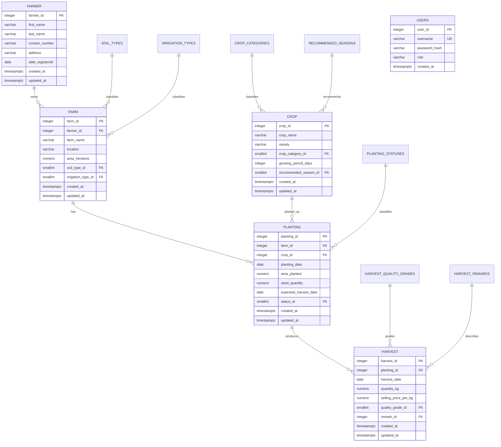

# Agriculture Information System (AIS)

**Course project:** AP3 Web Application Development Midterm Project  
**Institution:** Cebu Technological University  
**Application:** Native PHP with PDO, Supabase PostgreSQL, XAMPP Apache, and Tailwind CSS CDN

## 1. Project description

The AIS stores farmers, farms, crops, planting operations, and harvest yields. Users sign in as an administrator or staff member. The application provides validated CRUD screens, search and filters, dashboard totals, and reports that join related records.

## 2. Objectives

- Organize agriculture records in a relational PostgreSQL database.
- Demonstrate normalization, primary and foreign keys, and database constraints.
- Provide secure login with role-based access and hashed passwords.
- Validate records before saving and present useful messages.
- Summarize planting and harvest activity through a dashboard and reports.

## 3. Functional requirements

- Manage farmers, farms, crops, plantings, and harvests through create, read, update, and delete operations.
- Use lookup tables for soil type, irrigation type, crop category, recommended season, planting status, harvest quality, and harvest remarks.
- Show related farm, farmer, crop, quality, and remark data through SQL joins.
- Search, filter, sort, and paginate major data lists.
- Restrict permanent deletion to administrators and prevent deletes that would violate foreign keys.
- Provide a dashboard and the six required reports.
- Require login for application pages and store password hashes in `public.users`.

## 4. Entity relationship diagram

`USERS` authenticates application users. `created_at` and `updated_at` are maintained for the five business tables. The current application does not record the user responsible for each edit.

## 5. Normalization (UNF to 3NF)

### UNF

A single report-style record could contain farmer details, farm details, crop details, multiple planting entries, and multiple harvest entries in repeating groups. This duplicates farmer and farm data and does not store values atomically.

### 1NF

Represent each farmer, farm, crop, planting, and harvest as a separate row. Each cell contains one value. Repeating planting or harvest groups are represented as additional rows with identifiers.

### 2NF

Give each entity its own single-column primary key. Store facts with the key for the entity they describe: farmer details under `farmer_id`, farm details under `farm_id`, crop details under `crop_id`, planting details under `planting_id`, and harvest details under `harvest_id`. This removes partial dependencies on parts of a composite key.

### 3NF

Move predefined descriptive values into lookup tables and keep their IDs as foreign keys. For example, a farm stores `soil_type_id` and `irrigation_type_id`; the labels live in `soil_types` and `irrigation_types`. This prevents lookup labels from being repeated in each business record.

**Migration status:** `database/08_normalize_lookup_columns.sql` verifies old text labels against their lookup IDs and then drops duplicate text columns. Run that guarded migration in Supabase before using the updated create/edit forms. Until it is applied, the live database still contains redundant legacy labels and is not yet at the documented 3NF structure.

## 6. Data dictionary

| Table | Column | Type | Meaning / rule |
|---|---|---|---|
| farmer | farmer_id | integer PK | Identity for a farmer |
| farmer | first_name, last_name | varchar(50) | Required name parts |
| farmer | contact_number | varchar(20) | Required contact detail |
| farmer | address | varchar(150) | Required address; used by address filter |
| farmer | date_registered | date | Required registration date |
| farm | farm_id | integer PK | Identity for a farm |
| farm | farmer_id | integer FK | Owner in `farmer` |
| farm | farm_name | varchar(100) | Required farm name; unique per farmer |
| farm | location | varchar(150) | Required farm location |
| farm | area_hectares | numeric(8,2) | Positive farm area |
| farm | soil_type_id | smallint FK | `soil_types` lookup |
| farm | irrigation_type_id | smallint FK | `irrigation_types` lookup |
| crop | crop_id | integer PK | Identity for a crop/variety |
| crop | crop_name | varchar(80) | Required crop name |
| crop | variety | varchar(80) | Required variety; crop and variety are unique together |
| crop | crop_category_id | smallint FK | `crop_categories` lookup |
| crop | growing_period_days | integer | Positive number of days |
| crop | recommended_season_id | smallint FK | `recommended_seasons` lookup |
| planting | planting_id | integer PK | Identity for a planting operation |
| planting | farm_id, crop_id | integer FK | Related farm and crop |
| planting | planting_date | date | Date planted |
| planting | area_planted, seed_quantity | numeric(8,2) | Positive quantities |
| planting | expected_harvest_date | date | Must be after planting date |
| planting | status_id | smallint FK | `planting_statuses` lookup |
| harvest | harvest_id | integer PK | Identity for a harvest record |
| harvest | planting_id | integer FK | Planting that produced the harvest |
| harvest | harvest_date | date | Must not precede planting date in application validation |
| harvest | quantity_kg | numeric(10,2) | Positive harvested quantity |
| harvest | selling_price_per_kg | numeric(10,2) | Nonnegative unit price |
| harvest | quality_grade_id | smallint FK | `harvest_quality_grades` lookup |
| harvest | remark_id | integer FK | `harvest_remarks` lookup |
| users | user_id | integer PK | Identity for an application account |
| users | username | varchar(50) UNIQUE | Login name |
| users | password_hash | varchar(255) | Password hash, never plaintext |
| users | role | varchar(20) | `admin` or `staff` |

### Lookup values

| Lookup table | Values |
|---|---|
| soil_types | Loam; Clay Loam; Sandy Loam; Clay |
| irrigation_types | Rainfed; Irrigated; Drip Irrigation |
| crop_categories | Cereal; Vegetable; Fruit; Legume; Root Crop |
| recommended_seasons | Wet Season; Dry Season; Year Round |
| planting_statuses | Harvested; Growing |
| harvest_quality_grades | Grade A; Grade B; Grade C |
| harvest_remarks | Good Harvest; Acceptable Quality; Low Yield; Poor Quality; Damaged Harvest |

## 7. Relationships and constraints

- One farmer can own many farms; each farm references one farmer.
- One farm can have many plantings; each planting references one farm and one crop.
- One planting can have many harvest records.
- Lookup foreign keys connect farms, crops, plantings, and harvests to their controlled labels.
- Required business columns use `NOT NULL`; nonblank checks protect text fields.
- Farm area, crop growing period, planting area/seed quantity, harvest quantity, and harvest price have range checks.
- Crop name plus variety is unique; farm name is unique within one farmer.
- The planting expected-harvest date must be later than its planting date.
- `updated_at` triggers refresh timestamps on update.
- Deletes with dependent farm/planting/harvest rows are rejected with friendly application messages.

## 8. Application guide

1. Start Apache in XAMPP and open `http://localhost/FMidterm_Project/`.
2. Sign in with an account in `public.users`.
3. Use the navigation or dashboard cards to open Farmers, Farms, Crops, Plantings, Harvests, or Reports.
4. Use each list page's search/filter controls, sortable headings, and pagination.
5. Admins can add or edit records using the forms. Required fields and lookup selections are validated before saving.
6. Open a record to inspect joined details. Admins can create and edit records, and can delete after confirming. Staff accounts are view-only.
7. Open Reports to filter the six reports, including date-range summaries.
8. Log out using the navigation menu.
9. Use the Night mode switch below the role badge to toggle the display theme; the choice is saved in the browser.

For local setup, enable XAMPP's `pdo_pgsql` and `pgsql`, configure the ignored `config/db_credentials.php` using the example file, and keep real credentials private. Rotate the database password that was previously visible in a screenshot before deployment.

## 9. Testing results and remaining verification

- Previously tested locally through Apache: database connection, login/logout, role restrictions, CRUD flows for all five modules, validation, joins, search/filter/sort, and delete protections. Temporary test records were cleaned up.
- Dashboard was checked for Admin, Staff, and unauthenticated access.
- Reports were syntax-checked and their Supabase queries executed through Apache. The database returned zero business rows at that time; lookup tables returned their configured values.
- Latest smoke check: all 18 dashboard, list, create-form, reports landing, and report routes returned HTTP 200 for an authenticated local Admin session with no application error banners.
- Latest access check: 12 protected routes redirected unauthenticated requests to login; the login page returned HTTP 200.
- Latest static link audit: all 94 static local links/form targets and all 5 dynamic dashboard card routes resolve to project pages.
- The read-only checks matching migration 08's four label/lookup guards returned zero mismatches for farm, crop, planting, and harvest.
- The user confirmed migration 08 succeeded in Supabase; screenshots also show the seeded totals of 15 farmers, 15 farms, 10 crops, 30 plantings, and 20 harvests.
- A fresh transaction-wrapped CRUD/report smoke test against the populated Supabase schema remains unverified; the attempted local execution was blocked before it ran, and no test rows were written.
- Crop growing-period overflow validation was checked through Apache: 2147483648 is rejected and 2147483647 passes the range check.
- All PHP files passed syntax validation in the previous quality pass.
- Error-output scan found no raw SQLSTATE, exception message, or credential output.
- Responsive source markup has been reviewed. A rendered viewport check remains because headless Chrome and Edge failed to start their GPU processes in this environment.
- Migration 08 and the demo seed are confirmed applied in Supabase. Final end-to-end CRUD/report verification against the populated rows remains pending. The current local PHP writes target the normalized schema.
- Screenshots of the completed modules must be captured from the running application and added to the submission package.

## 10. Screenshots

Capture these screens after demo data is loaded: dashboard, farmer list/detail/form, farm list/detail/form, crop list/detail/form, planting list/detail/form, harvest list/detail/form, and each report. Use Chrome DevTools Device Toolbar at 390px, 768px, and 1440px widths for phone/tablet/desktop evidence. The current project folder does not yet contain those application screenshots.
